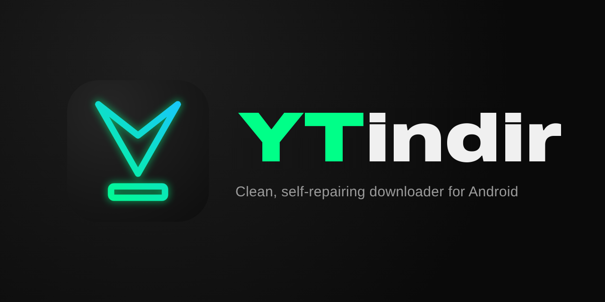

	

<h3 align="center">Un descargador de audio y vídeo para Android sencillo, rápido y que se repara solo</h3>

<a href="README.md">English</a> · <a href="README.tr.md">Türkçe</a> · <a href="README.ru.md">Русский</a> · <b>Español</b>

YTindir descarga audio y vídeo de YouTube, Instagram, TikTok, Facebook, VK, X y más de 1000 sitios web. Está basado en yt-dlp y YTDLnis, con una interfaz más sencilla, un aspecto renovado y una configuración que se mantiene funcionando cuando los sitios cambian.

## 🎬 Calidad de descarga

| Fuentes | Resoluciones compatibles |
| --- | --- |
| **YouTube** | 8K 60fps, 4K 60fps, 2K 60fps, 1080p FHD 60fps y otras resoluciones |
| **Instagram** | 2K 60fps, 1080p FHD 60fps (publicaciones, reels, historias) y otras resoluciones |
| **TikTok** | 1080p FHD 60fps (en calidad original) y otras resoluciones |
| **X (Twitter)** | 2K 60fps, 1080p FHD 60fps y otras resoluciones |
| **Facebook** | 2K 60fps, 1080p FHD 60fps y otras resoluciones |
| **VK** | 2K 60fps, 1080p FHD 60fps y otras resoluciones |
| **Otros sitios** | Las resoluciones compatibles más altas que ofrezca el sitio |

## ✨ Funciones

- ⚡ **Lista de descarga rápida para YouTube**: se abre en cuanto compartes un enlace, con la etiqueta de cada calidad (8K, 4K, 2K, FHD, HD), la tasa de fotogramas, el códec y el tamaño real del archivo; elige una y toca **Descargar**. También M4A (audio original), MP3 a 192 kbps y la miniatura original
- 📋 **Todos los formatos** para un control total: todas las pistas de vídeo y audio, con el audio original y el doblado agrupados por separado
- 📤 **Descarga desde el menú Compartir** de cualquier app, o directamente desde el menú de descarga de YouTube en las nuevas versiones de YouTube Morphe
- ✂️ **Recortar y encuadrar**: descarga solo una parte de un vídeo o encuádralo (por ejemplo, en cuadrado)
- 🎞️ **Vídeo compatible**: los vídeos VP9, AV1 y HEVC de redes sociales se convierten a H.264 con una calidad casi original, para los reproductores y editores que lo necesiten
- 🔁 **Autorreparación**: yt-dlp se actualiza solo; si una descarga falla por un cambio en un sitio, YTindir actualiza yt-dlp y vuelve a intentarlo por sí mismo
- 💬 **Errores claros**: cada error explica qué ha fallado y qué hacer, con soluciones de un toque, como reintentar sin comprobar el certificado
- 🎤 **Letras sincronizadas** incrustadas en los archivos de audio, **SponsorBlock**, nombres de archivo limpios y nombres cortos como `usuario_idpublicacion` para redes sociales
- 🍪 **Cookies**, **PO token**, proxy e IPv4 para el contenido difícil de descargar
- 🔄 **Actualizaciones desde la app**, copia de seguridad y restauración, y un terminal para comandos de yt-dlp
- 🎨 Colores **YTindir** o **Material You**, temas claro y oscuro, negro puro para pantallas AMOLED y una barra de navegación de cristal esmerilado
- 🌍 **12 idiomas**: inglés, turco, ruso, español, portugués (Brasil), alemán, francés, árabe, indonesio, chino (simplificado), japonés y coreano

## 📥 Instalación

Descarga el APK en **[Releases](https://github.com/RAMiK4/ytindir/releases/latest)**: **arm64** para la mayoría de los teléfonos, **universal** para cualquier dispositivo. YTindir se instala fácilmente, sin conflictos con otras apps, y las nuevas versiones se instalan sobre la anterior sin perder datos.

## 🙏 Créditos y licencia

- **[RAMiK4](https://github.com/RAMiK4)**: desarrollo, diseño y funciones adicionales de YTindir
- **[YTDLnis](https://github.com/deniscerri/ytdlnis)**, de Denis Çerri y sus colaboradores: YTindir es una versión modificada de este proyecto
- **[yt-dlp](https://github.com/yt-dlp/yt-dlp)** y **[youtubedl-android](https://github.com/yausername/youtubedl-android)**

Al igual que el original, YTindir tiene licencia **[GPL-3.0](LICENSE)**.

## ⚖️ Aviso legal

YTindir está pensado solo para contenido que tienes derecho a descargar. Respetar las condiciones de uso y los derechos de autor de los sitios que utilizas es tu responsabilidad.
