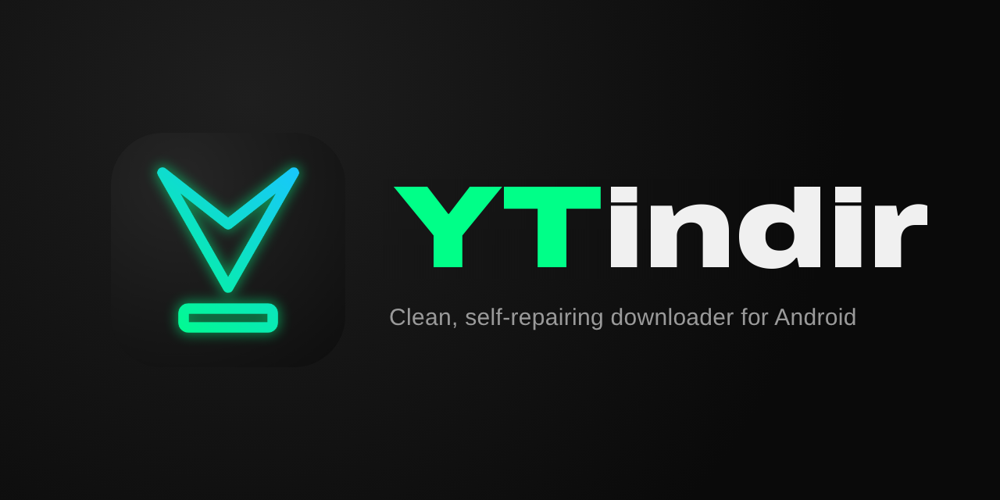

	

<h3 align="center">A clean, fast and self-repairing audio and video downloader for Android</h3>

<b>English</b> · <a href="README.tr.md">Türkçe</a> · <a href="README.ru.md">Русский</a> · <a href="README.es.md">Español</a>

YTindir downloads audio and video from YouTube, Instagram, TikTok, Facebook, VK, X and [more than 1000 other websites](https://github.com/yt-dlp/yt-dlp/blob/master/supportedsites.md). It is built on [yt-dlp](https://github.com/yt-dlp/yt-dlp) and [YTDLnis](https://github.com/deniscerri/ytdlnis), with a simpler interface, a refreshed look and a setup that keeps itself working when websites change.

## 🎬 Quality

| Sources | Supported resolutions |
| --- | --- |
| **YouTube** | 8K 60fps, 4K 60fps, 2K 60fps, 1080p FHD 60fps and other resolutions |
| **Instagram** | 2K 60fps, 1080p FHD 60fps and other resolutions |
| **TikTok** | 1080p FHD 60fps (in source quality) and other resolutions |
| **Facebook** | 2K 60fps, 1080p FHD 60fps and other resolutions |
| **VK** | 2K 60fps, 1080p FHD 60fps and other resolutions |
| **Other sites** | The highest resolution the site offers and other resolutions |

## ✨ Features

- ⚡ **Quick download list for YouTube**: opens as soon as you share a link, with each quality's badge (8K, 4K, 2K, FHD, HD), frame rate, codec and real file size; pick one and tap **Download**. Also M4A (source audio), MP3 192 kbps and the original thumbnail
- 📋 **All formats** when you want full control: every video and audio track, original and dubbed audio grouped apart
- 📤 **Download from the share menu** of any app, or straight from YouTube's own download menu in new versions of YouTube Morphe
- ✂️ **Trim and crop**: download only part of a video, or crop it (for example to a square)
- 🎞️ **Compatible video**: VP9, AV1 and HEVC from social media converted to H.264 at near-original quality, for players and editors that need it
- 🔁 **Self-repair**: yt-dlp updates itself; if a download fails after a website change, YTindir updates yt-dlp and retries on its own
- 💬 **Clear errors**: each error explains what went wrong and what to do, with one-tap fixes such as retrying without the certificate check
- 🎤 **Synced lyrics** embedded into audio files, **SponsorBlock**, clean file names and short names like `username_postid` for social media
- 🍪 **Cookies**, **PO token**, proxy and IPv4 options for content that is hard to download
- 🔄 **In-app updates**, backup and restore, and a terminal for yt-dlp commands
- 🎨 **YTindir** or **Material You** colours, light and dark themes, pure black for AMOLED screens and a frosted glass navigation bar
- 🌍 **12 languages**: English, Turkish, Russian, Spanish, Portuguese (Brazil), German, French, Arabic, Indonesian, Chinese (Simplified), Japanese and Korean

## 📥 Installation

Download the APK from **[Releases](https://github.com/RAMiK4/ytindir/releases/latest)**: **arm64** for most phones, **universal** for every device. The package name is `com.rl.ytindr`, so YTindir installs next to YTDLnis, and new versions install over the old one without losing data.

## 🙏 Credits and license

- **[RAMiK4](https://github.com/RAMiK4)**: YTindir's development, design and extra features
- **[YTDLnis](https://github.com/deniscerri/ytdlnis)** by Denis Çerri and contributors: YTindir is a modified version of this project
- **[yt-dlp](https://github.com/yt-dlp/yt-dlp)** and **[youtubedl-android](https://github.com/yausername/youtubedl-android)**
- Logo font: [Archivo](https://github.com/Omnibus-Type/Archivo), SIL Open Font License

Like the original, YTindir is licensed under **[GPL-3.0](LICENSE)**.

## ⚖️ Disclaimer

YTindir is meant only for content you have the right to download. Respecting the terms of use and copyright of the websites you use is your own responsibility.
