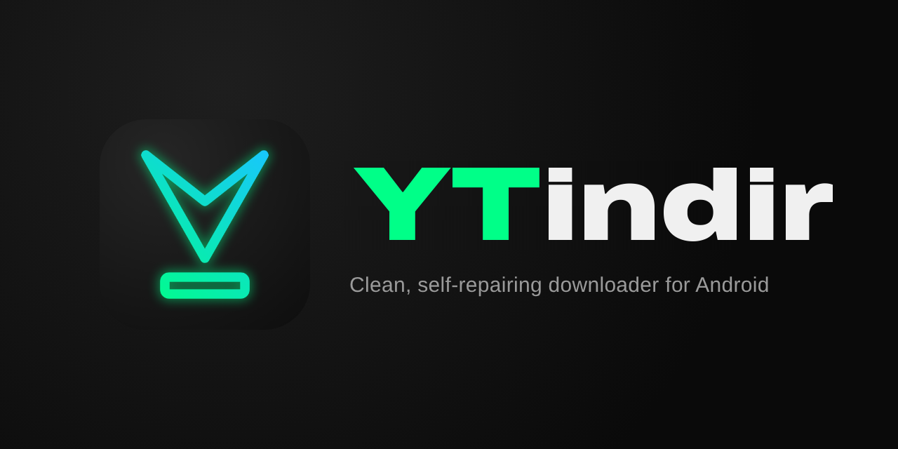

	

<b>English</b> · <a href="README.tr.md">Türkçe</a>

YTindir is a personal download app powered by [yt-dlp](https://github.com/yt-dlp/yt-dlp). It can download audio and video from [more than 1000 websites](https://github.com/yt-dlp/yt-dlp/blob/master/supportedsites.md). It is based on [YTDLnis](https://github.com/deniscerri/ytdlnis), with the advanced tools tucked away, a refreshed look, and a setup that keeps itself working when websites change.

## ✨ Features

- 🎵 **Audio and video downloads** with format and quality selection
- ✂️ **Trimming**: download only part of a video by entering minutes and seconds
- 📤 **Download from the share menu**: tap "Share" in any app and download the link straight away
- 🔁 **Self-repair**: yt-dlp updates itself from the nightly channel; if a download fails (for example after a website change), YTindir updates yt-dlp and retries the download once on its own
- 🔄 **In-app updates**: the app tells you when a new YTindir version is out and installs it for you
- 📋 **Copy the error log** with one tap
- 🛡️ **YouTube PO token** support (BgUtils) and **custom yt-dlp sources** for videos that are hard to download
- 🎤 **Synced lyrics** from lrclib.net, previewed in the app and embedded into the audio file
- 🍪 **Cookie support** for content you open with your own account
- 🎨 Its own **YTindir** colour tone or **Material You**, in light and dark themes, plus a high contrast mode (pure black for **AMOLED** screens) and a floating glass navigation bar
- 📶 Downloads over Wi-Fi and mobile data
- 🌍 **12 languages**: English, Turkish, Russian, Spanish, Portuguese (Brazil), German, French, Arabic, Indonesian, Chinese (Simplified), Japanese and Korean

## 🙈 Hidden features

To keep the app simple, these are hidden: terminal, command templates, source watching, scheduled downloads, SponsorBlock, subtitles, extra yt-dlp commands and advanced yt-dlp settings. The code is still there, so they can be brought back later if needed.

## 📥 Installation

Download the latest APK from the **[Releases](https://github.com/RAMiK4/ytindr/releases/latest)** page. The package name is `com.rl.ytindr`, so it can be installed next to the original YTDLnis. Every release is signed with the same key, so new versions install over the old one without losing data.

Every update to `main` is built by GitHub Actions and published automatically as an arm64 APK.

## 🙏 Credits and license

- **[YTDLnis](https://github.com/deniscerri/ytdlnis)** by Denis Çerri and contributors. YTindir is a modified version of this project.
- **[yt-dlp](https://github.com/yt-dlp/yt-dlp)** and **[youtubedl-android](https://github.com/yausername/youtubedl-android)**
- Logo font: [Archivo](https://github.com/Omnibus-Type/Archivo), SIL Open Font License

Like the original, this project is licensed under **[GPL-3.0](LICENSE)**.

## ⚖️ Disclaimer

YTindir is meant only for content you have the right to download. Respecting the terms of use and copyright of the websites you use is your own responsibility.
