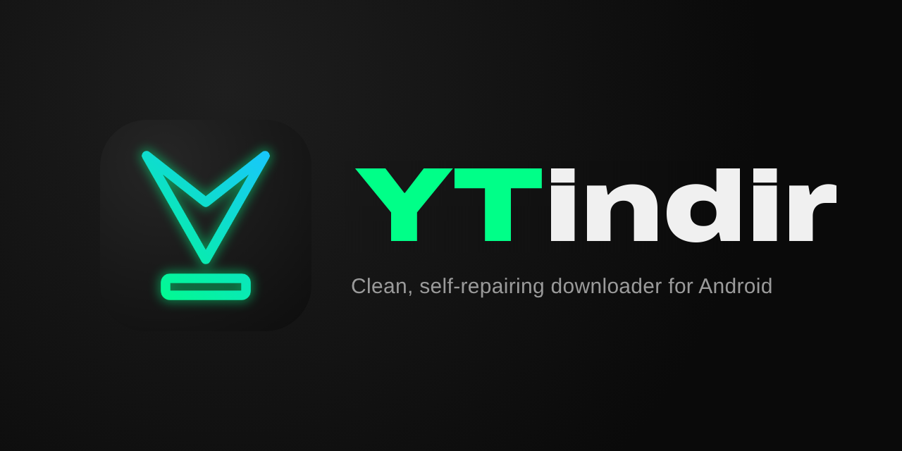

	

<h3 align="center">Простой, быстрый и самовосстанавливающийся загрузчик аудио и видео для Android</h3>

<a href="README.md">English</a> · <a href="README.tr.md">Türkçe</a> · <b>Русский</b> · <a href="README.es.md">Español</a>

YTindir скачивает аудио и видео с YouTube, Instagram, TikTok, Facebook, VK, X и [более чем 1000 других сайтов](https://github.com/yt-dlp/yt-dlp/blob/master/supportedsites.md). Приложение основано на [yt-dlp](https://github.com/yt-dlp/yt-dlp) и [YTDLnis](https://github.com/deniscerri/ytdlnis): интерфейс упрощён, внешний вид обновлён, а при изменениях на сайтах приложение само поддерживает себя в рабочем состоянии.

## 🎬 Качество

| Источники | Поддерживаемые разрешения |
| --- | --- |
| **YouTube** | 8K 60fps, 4K 60fps, 2K 60fps, 1080p FHD 60fps и другие разрешения |
| **Instagram** | 2K 60fps, 1080p FHD 60fps и другие разрешения |
| **TikTok** | 1080p FHD 60fps (в исходном качестве) и другие разрешения |
| **Facebook** | 2K 60fps, 1080p FHD 60fps и другие разрешения |
| **VK** | 2K 60fps, 1080p FHD 60fps и другие разрешения |
| **Другие сайты** | Максимальное разрешение, которое предлагает сайт и другие разрешения |

## ✨ Возможности

- ⚡ **Список быстрой загрузки для YouTube**: открывается сразу, как только вы поделились ссылкой; у каждого качества значок (8K, 4K, 2K, FHD, HD), частота кадров, кодек и реальный размер файла. Выберите вариант и нажмите **Скачать**. Также M4A (исходный звук), MP3 192 kbps и оригинальная обложка
- 📋 **Все форматы** для полного контроля: все видео- и аудиодорожки, оригинальная и дублированная озвучка сгруппированы отдельно
- 📤 **Загрузка из меню «Поделиться»** любого приложения или прямо из меню загрузки YouTube в новых версиях YouTube Morphe
- ✂️ **Обрезка и кадрирование**: скачивайте только часть видео или кадрируйте его (например, в квадрат)
- 🎞️ **Совместимое видео**: VP9, AV1 и HEVC из соцсетей конвертируются в H.264 почти без потери качества для плееров и редакторов, которым это нужно
- 🔁 **Самовосстановление**: yt-dlp обновляется сам; если загрузка не удалась из-за изменений на сайте, YTindir обновит yt-dlp и сам повторит попытку
- 💬 **Понятные ошибки**: каждая ошибка объясняет, что пошло не так и что делать, с решениями в одно касание, например повтор без проверки сертификата
- 🎤 **Синхронизированные тексты песен** в аудиофайлах, **SponsorBlock**, чистые имена файлов и короткие имена вида `username_postid` для соцсетей
- 🍪 **Cookies**, **PO token**, прокси и IPv4 для контента, который сложно скачать
- 🔄 **Обновления в приложении**, резервное копирование и восстановление, терминал для команд yt-dlp
- 🎨 Цвета **YTindir** или **Material You**, светлая и тёмная темы, чисто чёрная тема для AMOLED-экранов и панель навигации с эффектом матового стекла
- 🌍 **12 языков**: английский, турецкий, русский, испанский, португальский (Бразилия), немецкий, французский, арабский, индонезийский, китайский (упрощённый), японский и корейский

## 📥 Установка

Скачайте APK на странице **[Releases](https://github.com/RAMiK4/ytindir/releases/latest)**: **arm64** для большинства телефонов, **universal** для любых устройств. Имя пакета `com.rl.ytindr`, поэтому YTindir устанавливается рядом с YTDLnis, а новые версии ставятся поверх старой без потери данных.

## 🙏 Благодарности и лицензия

- **[RAMiK4](https://github.com/RAMiK4)**: разработка, дизайн и дополнительные функции YTindir
- **[YTDLnis](https://github.com/deniscerri/ytdlnis)**, Denis Çerri и участники проекта: YTindir является изменённой версией этого проекта
- **[yt-dlp](https://github.com/yt-dlp/yt-dlp)** и **[youtubedl-android](https://github.com/yausername/youtubedl-android)**
- Шрифт логотипа: [Archivo](https://github.com/Omnibus-Type/Archivo), SIL Open Font License

Как и оригинал, YTindir распространяется по лицензии **[GPL-3.0](LICENSE)**.

## ⚖️ Отказ от ответственности

YTindir предназначен только для контента, который вы имеете право скачивать. Соблюдение условий использования и авторских прав сайтов остаётся вашей ответственностью.
