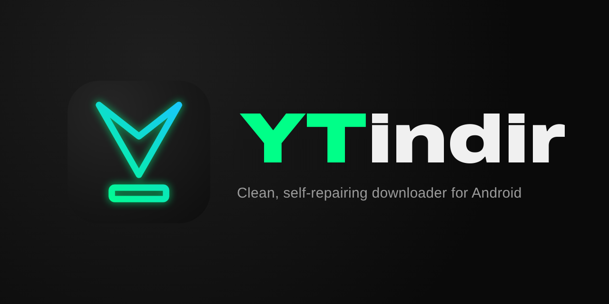

	

<h3 align="center">Android için sade, hızlı ve kendini onaran ses ve video indirici</h3>

<a href="README.md">English</a> · <b>Türkçe</b> · <a href="README.ru.md">Русский</a> · <a href="README.es.md">Español</a>

YTindir; YouTube, Instagram, TikTok, Facebook, VK, X ve [1000'den fazla siteden](https://github.com/yt-dlp/yt-dlp/blob/master/supportedsites.md) ses ve video indirir. [yt-dlp](https://github.com/yt-dlp/yt-dlp) ve [YTDLnis](https://github.com/deniscerri/ytdlnis) üzerine kuruludur; arayüzü sadeleştirilmiş, görünümü yenilenmiş ve sitelerdeki değişikliklere karşı kendi kendini güncelleyecek şekilde ayarlanmıştır.

## 🎬 Kalite

| Kaynaklar | Desteklenen çözünürlükler |
| --- | --- |
| **YouTube** | 8K 60fps, 4K 60fps, 2K 60fps, 1080p FHD 60fps ve diğer çözünürlükler |
| **Instagram** | 2K 60fps, 1080p FHD 60fps (gönderi, reels, hikâye) ve diğer çözünürlükler |
| **TikTok** | 1080p FHD 60fps (kaynak kalitede) ve diğer çözünürlükler |
| **X (Twitter)** | 2K 60fps, 1080p FHD 60fps ve diğer çözünürlükler |
| **Facebook** | 2K 60fps, 1080p FHD 60fps ve diğer çözünürlükler |
| **VK** | 2K 60fps, 1080p FHD 60fps ve diğer çözünürlükler |
| **Diğer siteler** | Sitenin sunduğu desteklenen en yüksek çözünürlükler |

## ✨ Özellikler

- ⚡ **YouTube için hızlı indirme listesi**: bağlantıyı paylaşınca hemen açılır; her kalitenin etiketi (8K, 4K, 2K, FHD, HD), kare hızı, kodeği ve gerçek dosya boyutuyla. Birini seçip **İndir**'e dokunmanız yeterli. M4A (kaynak ses), MP3 192 kbps ve orijinal küçük resim seçenekleri de var
- 📋 Tam kontrol için **Tüm formatlar**: tüm video ve ses parçaları, orijinal ve dublajlı sesler ayrı gruplarda
- 📤 Herhangi bir uygulamanın **Paylaş menüsünden** ya da yeni YouTube Morphe sürümlerinde doğrudan YouTube'un kendi indirme menüsünden indirme
- ✂️ **Kesme ve kırpma**: videonun yalnızca bir bölümünü indirin ya da kırpın (örneğin kare)
- 🎞️ **Uyumlu video**: sosyal medyadaki VP9, AV1 ve HEVC videolar, gereken oynatıcı ve düzenleyiciler için orijinale yakın kalitede H.264'e dönüştürülür
- 🔁 **Kendini onarma**: yt-dlp kendini günceller; bir sitedeki değişiklik yüzünden indirme başarısız olursa YTindir yt-dlp'yi güncelleyip kendiliğinden yeniden dener
- 💬 **Anlaşılır hatalar**: her hata neyin yanlış gittiğini ve ne yapılacağını açıklar; sertifika denetimi olmadan yeniden deneme gibi tek dokunuşluk çözümler sunar
- 🎤 Ses dosyalarına gömülen **senkron şarkı sözleri**, **SponsorBlock**, temiz dosya adları ve sosyal medya için `kullaniciadi_gonderiid` gibi kısa adlar
- 🍪 İndirmesi zor içerikler için **çerezler**, **PO token**, proxy ve IPv4 seçenekleri
- 🔄 **Uygulama içi güncelleme**, yedekleme ve geri yükleme, yt-dlp komutları için terminal
- 🎨 **YTindir** ya da **Material You** renkleri, açık ve koyu tema, AMOLED ekranlar için saf siyah ve buzlu cam görünümlü alt menü
- 🌍 **12 dil**: İngilizce, Türkçe, Rusça, İspanyolca, Portekizce (Brezilya), Almanca, Fransızca, Arapça, Endonezce, Çince (Basitleştirilmiş), Japonca ve Korece

## 📥 Kurulum

APK'yı **[Releases](https://github.com/RAMiK4/ytindir/releases/latest)** sayfasından indirin: çoğu telefon için **arm64**, tüm cihazlar için **universal**. Paket adı `com.rl.ytindr` olduğundan YTindir, YTDLnis'in yanına kurulur; yeni sürümler eskisinin üzerine veriler silinmeden kurulur.

## 🙏 Emeği geçenler ve lisans

- **[RAMiK4](https://github.com/RAMiK4)**: YTindir'in geliştirmesi, tasarımı ve ek özellikleri
- **[YTDLnis](https://github.com/deniscerri/ytdlnis)**, Denis Çerri ve katkıda bulunanlar: YTindir bu projenin değiştirilmiş bir sürümüdür
- **[yt-dlp](https://github.com/yt-dlp/yt-dlp)** ve **[youtubedl-android](https://github.com/yausername/youtubedl-android)**
- Logo yazı tipi: [Archivo](https://github.com/Omnibus-Type/Archivo), SIL Open Font License

Orijinali gibi YTindir de **[GPL-3.0](LICENSE)** lisanslıdır.

## ⚖️ Sorumluluk reddi

YTindir yalnızca indirme hakkınız olan içerikler içindir. Kullandığınız sitelerin kullanım koşullarına ve telif haklarına uymak sizin sorumluluğunuzdadır.
